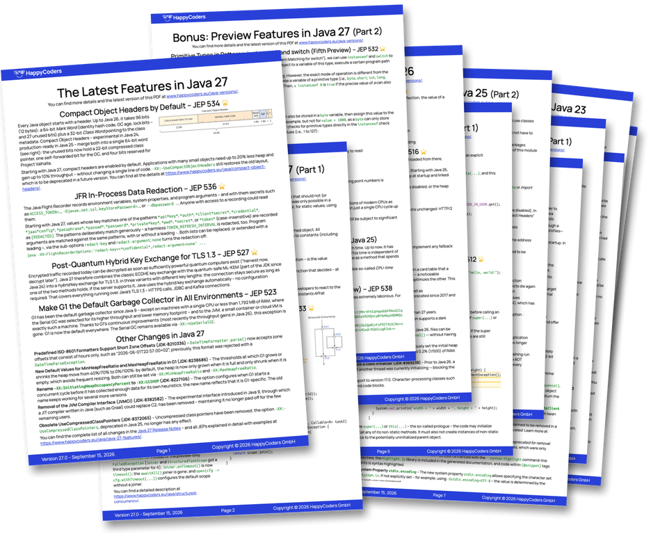
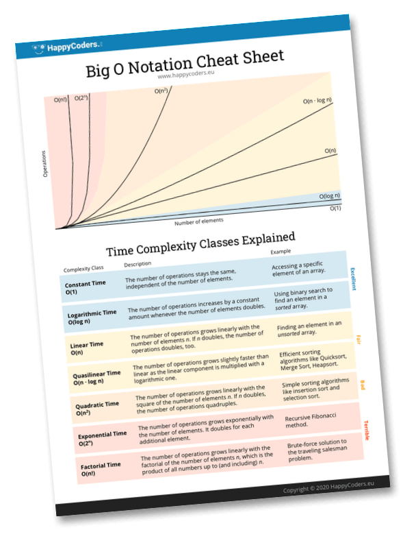

# Project Valhalla

Example code for the HappyCoders.eu article on Project Valhalla and value objects in Java 28 – JEP 401 (Value Objects) and JEP 539 (Strict Field Initialization in the JVM). The article will appear in German and English on [happycoders.eu](https://www.happycoders.eu/).

## Requirements

Value objects are a preview feature of Java 28. You need an early-access build of JDK 28 ([jdk.java.net/28](https://jdk.java.net/28/)) and must enable preview features. All outputs in the article and in `results/` come from build 28-ea+23; layouts and diagnostic options may change until the release.

## Programs

The programs are compact source files in the unnamed package, one directory per topic. Value classes that are not records live in their own files: a class declared in a compact source file is an inner class of the implicitly declared class, and an inner value class gets a hidden `this$0` field that makes it larger and harder to flatten. Records are implicitly static and are not affected.

Run a program from its directory with the source launcher, which also compiles the other files it needs from the same directory:

```
cd src/main/java/declaring
java --enable-preview MoneyDemo.java
```

| Directory | Programs |
|---|---|
| `motivation` | `IdentitySurprises` (`==` on `Integer` and `LocalDate`, run with and without preview), `WrapperConstructor` |
| `jdk` | `HasIdentity` – `Objects.hasIdentity()` on JDK classes |
| `declaring` | `MoneyDemo` with the value class `Money` |
| `equality` | `PersonComparison`, `FractionDemo`, `NaNValues`, `PixelDemo`, `DeepComparison` – where `==` and `equals()` differ |
| `restrictions` | `IdentityOperations`, `WeakRefWarning`, `CloneValue` – operations that need identity |
| `inheritance` | `Numbers`, `ShapesDemo` – abstract value classes |
| `construction` | `UserNameDemo`, `RecordThisLeak` – the constructor rules |
| `serialization` | `broken/SerializeValues` and `proxy/SerializeMoney` – serialization with `writeReplace()`/`readResolve()` |
| `reflection` | `ReflectValue` – deep reflection on identity and value classes |
| `layout` | `PrintLayouts` – loads the classes whose field and array layouts the article shows |
| `scalarization` | `Scalarization` – allocated bytes per call for value and identity records |
| `header` | `MarkWord` – reads the mark word of a few objects with `sun.misc.Unsafe` |
| `footprint` | `DateArrayFootprint`, `PointArrayFootprint` – heap class histograms |

`src/compile-errors` holds the examples that the compiler rejects, one directory per topic.

## Layouts

`PrintLayouts` prints the field layouts of all loaded classes with diagnostic VM options:

```
cd src/main/java/layout
java --enable-preview -Xshare:off -XX:+UnlockDiagnosticVMOptions \
     -XX:+PrintFieldLayout -XX:+PrintFlatArrayLayout PrintLayouts.java
```

`-Xshare:off` makes the JDK classes such as `LocalDate` appear in the output; otherwise the JVM loads them from the CDS archive without printing their layout.

## Reproducing all outputs

`scripts/run-examples.sh <path-to-jdk-28>` runs every program with the options used in the article, compiles the compile-error examples, and writes all outputs to `results/<build>/`. It takes about half a minute and exits with an error if a program ends differently than the article says – a program fails that should run, or one runs that should fail.

`scripts/compare-results.py results/<build>` compares a fresh run with the outputs in the last commit. It masks what changes from run to run (warmup numbers, hash values, the class-pointer bits of the mark word, histogram ranks) and reports every other difference.

The GitHub workflow does both on every push and once a week with the newest JDK 28 early-access build from jdk.java.net. A new build that changes a layout or a message shows up as a warning in the job summary; the build itself only fails on an unexpected exit.


## Benchmarks

`benchmarks/` is a Maven project with the JMH benchmarks of the article's run-time measurements: the sum over one million elements of an `int[]`, an `Integer[]` and a `LocalDate[]`, with and without preview features, and – as a contrast – over an array of a value record that the JVM does not flatten. Each benchmark runs once with the objects in allocation order and once with the array shuffled, so that the loop jumps across the heap.

`scripts/run-benchmarks.sh <path-to-jdk-28>` builds the benchmarks and writes the raw JMH results, the machine details and a summary table to `results/<build>/jmh/`. It takes about 18 minutes; run it on an otherwise idle machine.

The benchmarks come as two jars, because a class compiled with preview features only loads in a JVM with preview features enabled: `benchmarks.jar` (`mvn package`) runs with and without `--enable-preview`, `benchmarks-preview.jar` (`mvn package -P preview`) declares its own value record and needs it.


<!-- happycoders-resources:start -->
<!-- Generated from happycoders-website-astro/data/github-readme by scripts/content/sync-github-readmes.mjs. Edit there, not here. -->

## <br>Additional Resources

### <br>Java Versions PDF Cheat Sheet

**Stay up-to-date** with the latest Java features with this **free** [PDF Cheat Sheet](https://www.happycoders.eu/java-versions/)!

[](https://www.happycoders.eu/java-versions/)

* Avoid lengthy research with this **concise overview of all Java versions from Java 10 to Java 27**.
* **Discover the innovative features** of each new Java version, summarized on a single page.
* **Impress your team** with your up-to-date knowledge of the latest Java version.

👉 [Download the free Java Versions PDF](https://www.happycoders.eu/java-versions/)<br>

_(Hier geht's zur deutschen Version &rarr; [Java-Versionen PDF](https://www.happycoders.eu/de/java-versionen/))_


### <br>The Big O Cheat Sheet

With this **free** [1-page PDF cheat sheet](https://www.happycoders.eu/big-o-cheat-sheet/), you'll always have the **7 most important complexity classes** at a glance.

[](https://www.happycoders.eu/big-o-cheat-sheet/)

* **Always choose the most efficient data structures** and thus increase the performance of your applications.
* **Be prepared for technical interviews** and confidently present your algorithm knowledge.
* **Become a sought-after problem solver** and be known for systematically tackling complex problems.

👉 [Download the free Big O Cheat Sheet](https://www.happycoders.eu/big-o-cheat-sheet/)<br>

_(Hier geht's zur deutschen Version &rarr; [O-Notation Cheat Sheet](https://www.happycoders.eu/de/o-notation-cheat-sheet/))_


### <br>HappyCoders Newsletter
👉 Want to stay on top of modern Java?
Sign up for the [HappyCoders newsletter](https://www.happycoders.eu/newsletter/) – Modern Java: new versions & features, performance, and JVM insights – once a month.

_(Hier geht's zur deutschen Version &rarr; [HappyCoders-Newsletter deutsch](https://www.happycoders.eu/de/newsletter/))_


### <br>🇩🇪 An alle Java-Entwickler:innen, die durch fundierte Kenntnisse über Datenstrukturen besseren Code schreiben wollen

Trage dich jetzt unverbindlich auf die [Warteliste](https://www.happycoders.eu/de/mastering-data-structures-warteliste/) von „Mastering Data Structures in Java“ ein, und erhalte das beste Angebot!

[](https://www.happycoders.eu/de/mastering-data-structures-warteliste/)

👉 [Zur Warteliste](https://www.happycoders.eu/de/mastering-data-structures-warteliste/)
<!-- happycoders-resources:end -->
